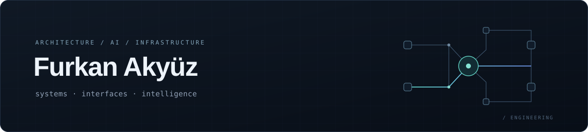

<p align="center">
  
</p>

<table width="100%">
  <tr>
    <td width="50%" valign="top"><sub>PRIMANORTH</sub><br/><strong>Technical Founder</strong></td>
    <td width="50%" valign="top"><sub>KORKUTTEKNOLOJI</sub><br/><strong>Senior System Architect</strong></td>
  </tr>
</table>

<br/>

### Focus

```text
architecture    boundaries · state · contracts
agent systems   orchestration · memory · verification
operations      observability · recovery · delivery
```

### Working stack

`TypeScript` &nbsp; `Python` &nbsp; `Node.js` &nbsp; `PostgreSQL` &nbsp; `Docker`

---

<p align="center">
  <a href="https://www.linkedin.com/in/furkan-akyuz/">LinkedIn</a>
</p>
