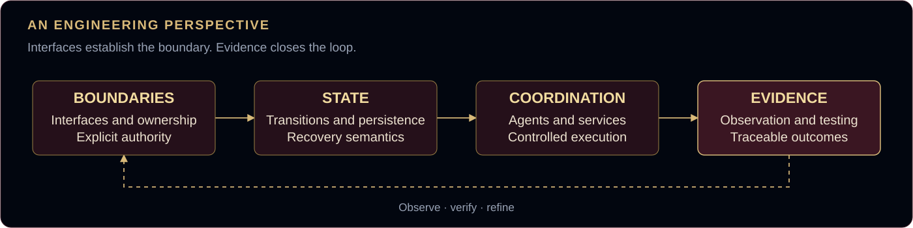

<p align="center">
  
</p>

<table width="100%">
  <tr>
    <td width="50%" valign="top"><sub>◆ PRIMANORTH</sub><br/><strong>Technical Founder</strong></td>
    <td width="50%" valign="top"><sub>◆ KORKUTTEKNOLOJI</sub><br/><strong>Senior System Architect</strong></td>
  </tr>
</table>

<p align="center"><strong>Systems architecture · Agent systems · Operational reliability</strong></p>

## ◆ Architecture

System boundaries, data contracts, and state transitions are the starting points. The questions that follow are practical: where authority lives, which state must survive interruption, and how a system explains its behavior.

- **Interfaces:** ownership, contracts, and integration boundaries.
- **State:** persistence, consistency, and explicit transition semantics.
- **Coordination:** interactions between services, workers, and external systems.



## ◈ Agent systems

Technical interests include multi-model orchestration, context continuity, tool interfaces, and evaluation. The architectural concerns are familiar: defined responsibilities, bounded authority, recoverable state, and evidence for the outcome.

| Concern | Questions |
| :--- | :--- |
| **Context and memory** | What information is retained, where did it come from, and when is it stale? |
| **Tools and authority** | Which actions are permitted, and which component enforces that boundary? |
| **Evaluation** | What was observed, what actually executed, and which result supports the conclusion? |

## ⚙ Reliability and delivery

Observability, failure recovery, and verification belong in the design. Useful operating signals connect the intended action to the state transition, the executed checks, and the resulting system behavior.

```text
design       interfaces · invariants · state
execution    coordination · bounded actions · continuity
operations   telemetry · recovery · verification
```

## ⌘ Tooling

| Layer | Technologies |
| :--- | :--- |
| **Languages** | TypeScript · JavaScript · Python · SQL |
| **Services and interfaces** | Node.js · NestJS · React · Next.js |
| **Data and infrastructure** | PostgreSQL · Redis · Docker · Nginx |
| **Verification and delivery** | Playwright · Git · CI/CD |

---

<p align="center">
  <a href="https://www.linkedin.com/in/furkan-akyuz/">LinkedIn</a>
</p>
